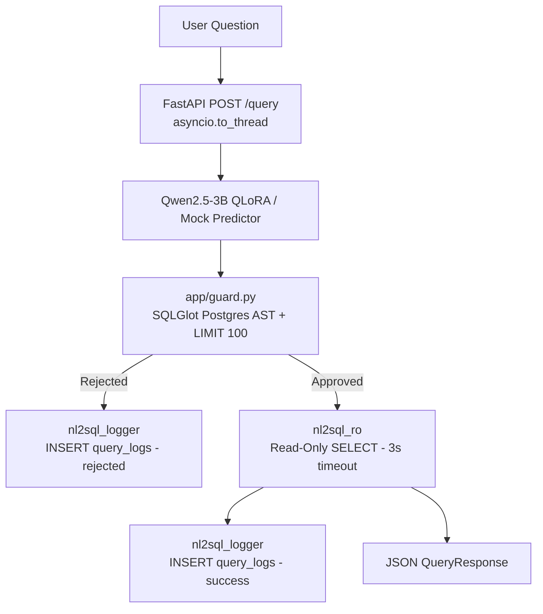

# Local NL-to-SQL LLM (QLoRA) & Hardened FastAPI Microservice

Production-grade Natural-Language-to-SQL system fine-tuning `Qwen/Qwen2.5-3B-Instruct` via 4-bit NF4 QLoRA on schema-disjoint Spider splits, evaluated with read-only SQLite execution accuracy, and served behind an AST-validated FastAPI + PostgreSQL microservice.

## Architecture



### Design & Security Guardrails
- **Schema-Disjoint Splits:** `training/prepare_dataset.py` extracts compact `CREATE TABLE` DDL from `sqlite_master` and enforces zero `db_id` overlap across train/validation splits.
- **Completion-Only Loss:** `training/train_qlora.py` uses TRL `SFTConfig(completion_only_loss=True)` with `prompt`/`completion` formatting so prompt/DDL tokens are masked (`-100`) during QLoRA training.
- **Read-Only Evaluation:** `eval/sqlite_exec.py` runs SQLite `?mode=ro` with a `set_progress_handler` 3.0s monotonic timeout and duplicate-preserving multiset (or `ORDER BY` list) comparison.
- **Defense-in-Depth SQL Serving:** `app/guard.py` validates the full Postgres AST via `sqlglot` (single `Select`/`Union`, blocks writable CTEs, DML/DDL, `INTO`, `Lock`, dangerous `pg_*` functions, and enforces `LIMIT <= 1000`), backed by separate `nl2sql_ro` (`SELECT` only + `statement_timeout = 3000ms`) and `nl2sql_logger` (`INSERT` only on `query_logs`) PostgreSQL roles.

## Quickstart

### 1. Environment & Offline Dataset Smoketest
```bash
python -m venv .venv
pip install -r requirements.txt
python -m training.prepare_dataset --smoketest
```

### 2. QLoRA Dry-Run & Fine-Tuning (Colab/Kaggle GPU)
```bash
# Local CPU/GPU batch-masking check (pass --model-override for a local model dir)
python -m training.train_qlora --dry-run --smoketest --model-override <local_model_dir>

# Full Spider preparation & QLoRA training on GPU (auto-detects bf16 vs T4 fp16 fallback)
python -m training.prepare_dataset --db-dir data/spider/database
python -m training.train_qlora
```

### 3. 3-Way Evaluation Harness
```bash
# Offline smoketest verification
python -m eval.evaluate --smoketest --mock-inference

# Full 3-way evaluation (Base Zero-Shot, Base 3-Shot, QLoRA Fine-Tuned)
python -m eval.evaluate --adapter-dir outputs/qwen2.5-3b-nl2sql-qlora
```

### 4. Docker Compose Microservice
```bash
cp .env.example .env
docker compose up -d --build
curl -f http://localhost:8000/health
curl -X POST http://localhost:8000/query \
  -H "Content-Type: application/json" \
  -d '{"question": "How many employees are there?"}'
docker compose down
```

## Benchmarks

Evaluated on the full held-out Spider validation set (**1,034 examples across 20 unseen schemas**) using a Kaggle Tesla T4 GPU (`15 GB` VRAM, greedy decoding `do_sample=False`, `3.0s` read-only SQLite execution timeout).

### 3-Way Evaluation Results

| Mode | EX (%) | Valid SQL (%) | Raw Valid SQL (%) | P50 Latency (ms) | P95 Latency (ms) | Peak VRAM (MB) |
| :--- | ---: | ---: | ---: | ---: | ---: | ---: |
| `base_zero_shot` | 53.68 | 83.17 | 83.17 | 2774.77 | 5386.83 | 2172.88 |
| `base_3_shot` | 51.06 | 81.82 | 81.82 | 3687.51 | 6538.00 | 2684.80 |
| `qlora_finetuned` | **70.12** | **91.10** | **91.10** | 3187.21 | 9793.53 | 2285.94 |

### QLoRA Training Summary (Kaggle T4, `float16` + 4-bit NF4)

- **Steps:** `1,314` (`completion_only_loss=true`)
- **Train Loss:** `0.1033` (`0.10331352102702067`) | **Eval Loss:** `0.3782` (`0.37822282314300537`)
- **Training Peak VRAM:** `5,221.55 MB`

### Key Takeaways

- **+16.44 pp Execution Accuracy** over zero-shot (`53.68%` → `70.12%`) and **+19.06 pp** over 3-shot (`51.06%` → `70.12%`) on 20 unseen Spider schemas (`1,034` val examples).
- **+7.93 pp Valid SQL** improvement (`83.17%` → `91.10%`) with zero post-processing gap (`Raw Valid SQL% == Valid SQL%`).
- **Why QLoRA beats 3-shot prompting on a 3B model:** 3-shot drops EX accuracy (`-2.62 pp` vs. zero-shot) while increasing P50 latency (`+913 ms`, `2774.77 ms` → `3687.51 ms`) and Peak VRAM (`+512 MB`, `2172.88 MB` → `2684.80 MB`) from longer KV-cache context.

Full machine-readable outputs:
- [eval/results/benchmark_summary.md](eval/results/benchmark_summary.md)
- [eval/results/benchmark_summary.json](eval/results/benchmark_summary.json)
- [eval/results/training_summary.json](eval/results/training_summary.json)

## Verification & Linting
```bash
ruff check .
pytest -v
```
